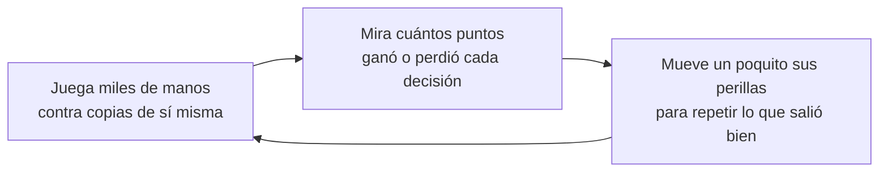
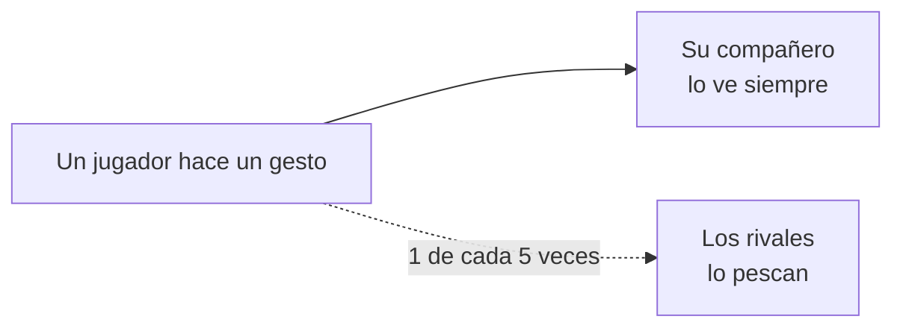
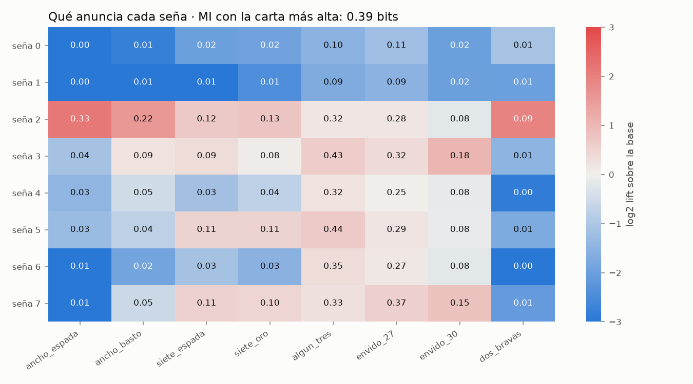
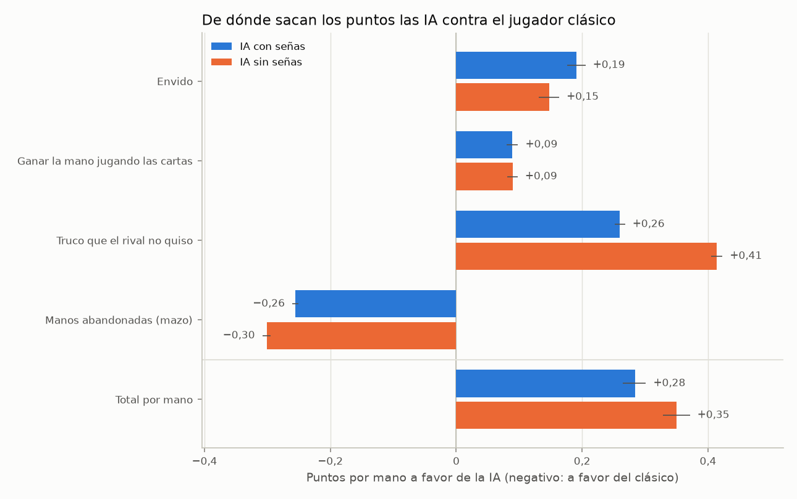
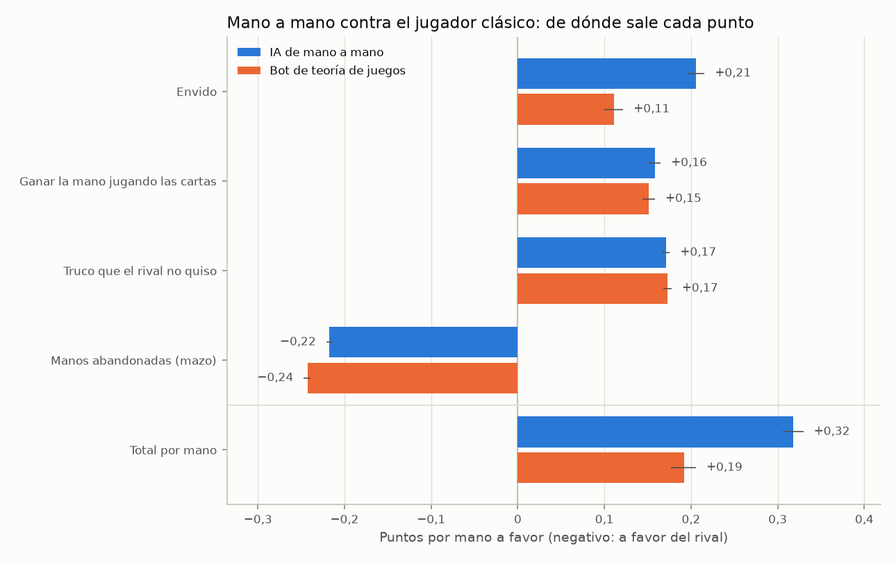

# 🃏 Truco con señas

**Unas inteligencias artificiales aprendieron solas a jugar al truco en pareja. Nadie les dijo qué significa cada seña, y se inventaron su propio idioma.**

### [▶ Jugar en el navegador](https://francataldi.github.io/truco-senas/)

No hay que instalar nada. Jugás en pareja con una IA de compañera, o mano a mano contra el bot que elijas, y ves en vivo qué piensa.

---

## En 30 segundos

- Cuatro jugadores artificiales jugaron **15 millones de manos** de truco entre ellos. Al principio tiraban cualquier cosa; al final le ganan **3 de cada 4 partidos** a un jugador programado con las reglas de alguien que sabe jugar.
- Antes de cada mano podían hacerle a su compañero uno de **8 gestos sin significado**. Terminaron usándolos como las señas del truco: "boca a la derecha" pasó a querer decir "tengo un ancho".
- Cuando los rivales podían espiar los gestos, **dejaron de avisar sus cartas**.
- Al jugador clásico le ganan sobre todo **apretándolo**: cantan seguido, a veces mintiendo, y el clásico se achica.
- Mano a mano hay otra red neuronal, entrenada de a dos, que le gana al clásico **85 de cada 100 partidos**.
- La demo se juega en el navegador, en pareja o mano a mano contra esa red.

## Si nunca oíste hablar de inteligencia artificial

Un programa común sigue reglas que escribió una persona: "si tenés 27 o más de envido, cantá envido". Acá no hay reglas. El programa **aprende probando**, como alguien que aprende truco solo, jugando miles de partidas y quedándose con lo que le hizo ganar.

Por dentro, cada jugador es una **red neuronal**: una fórmula enorme con unas 900.000 perillas que transforma lo que ve (sus cartas, lo que se jugó, el marcador, las señas) en una decisión (qué carta tirar, si cantar, si aceptar). Al principio las perillas están en cualquier lado y juega al azar. Después de cada tanda de manos, cada perilla se mueve un poquito en la dirección que hubiera dado más puntos.

Eso se repitió 3.000 veces, unos 15 millones de manos, en menos de dos horas. Se llama **aprendizaje por refuerzo**: nadie le muestra ejemplos de cómo se juega, solo le dice cuántos puntos sacó.

Las palabras técnicas que aparecen abajo están explicadas en el [glosario](#glosario-de-machine-learning-en-castellano).

## Las señas

En el truco de verdad los compañeros se hacen señas a escondidas: levantar las cejas es el ancho de espada, guiñar el ojo es el de basto. Si un rival las ve, se aprovecha.

Acá, antes de cada mano, cada jugador elige uno de 8 gestos: cejas, guiño, boca a la derecha, boca a la izquierda, labio mordido, lengua afuera, ojos cerrados y beso. **Ninguno significa nada de antemano.** Lo único que buscan las IA es ganar puntos; si los gestos les sirven para eso, tienen que inventarles un significado.

Las preguntas eran cuatro:

1. ¿Inventan un idioma, o los gestos quedan como ruido?
2. Si lo inventan, ¿qué significa cada seña?
3. ¿Qué pasa con ese idioma cuando los rivales espían?
4. ¿El idioma sale del juego, o de las ayuditas que les dimos al entrenarlas?

## Qué descubrimos

### 1. Se inventaron un idioma, y se parece al de las personas

Mirando 80.000 señas al empezar el partido, cada gesto pasó a anunciar algo concreto:

| Gesto | Qué anuncia | Qué tan seguido es cierto |
|---|---|---|
| Boca a la derecha | **tengo un ancho** | 70% |
| Lengua afuera | **tengo 27 o más de envido** | 52% |
| Ojos cerrados | tengo un tres | 44% |
| Beso | tengo un siete bravo | 43% |
| Boca a la izquierda · Cejas · Guiño | a lo sumo tengo un dos | 83% · 74% · 71% |
| Labio mordido | nada claro | casi no se usa |

**¿Cuánto ayuda una seña?** Supongamos que tenés que adivinar cuál es la mejor carta de tu compañero, entre 7 tipos (un ancho, un siete bravo, un tres, un dos, y así). Sin ver ninguna seña, lo mejor que podés hacer es decir siempre "un tres", y acertás el **22%** de las veces. Mirando la seña de la IA acertás el **41%**: casi el doble. Los especialistas lo miden en *bits* (acá, 0,52 bits); el glosario explica qué son.

Nadie les enseñó la convención humana y llegaron a algo parecido: la seña más clara es la del ancho, como en una mesa de verdad. Avisar que la mano es floja también le sirve al compañero.

La IA también ve el marcador, y el idioma se corre a medida que avanza el partido. A 15 a 15, por ejemplo, "ojos cerrados" pasa a anunciar envido en vez de un tres. "Boca a la derecha = tengo un ancho" se mantiene todo el partido.

### 2. Las señas valen partidos

Para saber cuánto vale algo, se lo sacamos y medimos cuánto pierde. Los especialistas le dicen **ablación**. Pusimos a la IA contra una copia exacta de sí misma, que tiene que ganar la mitad de las veces, y a una de las dos le rompimos algo. Cada condición se jugó en 1.000 partidos, y **cada reparto se jugó dos veces con las parejas cambiadas de lugar**, para que las cartas no favorezcan a nadie.

Sin tocar nada gana el **49,4%**, como tiene que ser. Esto pasa cuando le rompemos algo:

| Qué le sacamos | Cuántos partidos de cada 100 pierde de más |
|---|---|
| Entender al compañero: sus señas le llegan mezcladas al azar | **16** (entre 13 y 19) |
| Señalar: hace siempre el mismo gesto | **17** (entre 14 y 20) |
| Todas las señas, propias y espiadas | **21** (entre 18 y 23) |
| Espiar: nunca ve las señas de los rivales | 1 (entre −2 y 4): no se distingue de cero |
| Creerle a lo espiado: ve las señas rivales, pero cambiadas | **7** (entre 4 y 10) |

Los números entre paréntesis son el **margen de error**: con más partidos se achicaría, pero el valor real está casi seguro adentro. Las señas valen mucho. Espiar, en cambio, casi no suma; lo curioso es que la IA sí le cree a lo que espía, y si se lo cambiamos, pierde.

### 3. Cada pareja inventa su propio idioma

Entrenamos 5 parejas por separado, cada una con su propia tirada de azar (su **semilla**). Cada una le gana al jugador clásico el **70%** con su compañero de siempre. Si juntamos compañeros de parejas distintas, baja al **57%**: es como jugar con alguien que hace gestos al azar. Los diccionarios de dos parejas coinciden tan poco como si se hubieran sorteado, pero si se reordenan los gestos para que encajen, coinciden bastante más: inventaron ideas parecidas con palabras distintas. Es lo que pasa con los idiomas: la palabra es arbitraria, lo que importa es que los dos la entiendan igual.

### 4. Con espías, se callan

Entrenamos otra pareja con rivales que pescan la mitad de los gestos. Como avisar las cartas también le servía al rival, **dejaron de hacerlo**: mirando su seña, adivinar la mejor carta pasa de 22% a apenas 23%. Lo único que siguen avisando, un poco, es si tienen mucho envido. Hacer siempre el mismo gesto ya no les cuesta nada.

### 5. El idioma no lo fabricaron las ayuditas

Al entrenarlas les dimos dos empujones chicos para que hablen y escuchen: un premio por hacer señas que dependan de la mano (el **bonus de información**) y una tarea extra de adivinar las cartas del compañero (la **cabeza auxiliar**). ¿Y si el idioma salió de ahí y no del juego? Para saberlo entrenamos tres parejas más, iguales en todo, sacándoles una ayuda, la otra o las dos. A eso se le dice **control**.

| Pareja | Con su seña, adivinás la mejor carta | Entender al compañero le vale |
|---|---|---|
| Con las dos ayudas (la principal) | 41% de las veces | 16 partidos de cada 100 |
| Sin el bonus de información | 37% | 14 |
| Sin la cabeza auxiliar | 27% | 14 |
| Sin ninguna de las dos (el diccionario de arriba) | 37% | 13 |

Sin ver la seña se acierta el 22%. **Las cuatro se inventaron un idioma y lo usan**, así que el idioma sale del juego. Las diferencias entre ellas no se pueden atribuir a las ayudas: hay una sola pareja de cada tipo, y entre parejas iguales con distinta semilla ya hay diferencias así de grandes.

### 6. Por qué cada bot le gana al otro

Para explicar un resultado no alcanza con contar partidos ganados. La herramienta [`comparar.py`](scripts/comparar.py) juega 2.000 partidos duplicados entre dos bots y mide dos cosas:

- **De dónde sale cada punto.** En el truco hay cuatro formas de sumar: ganar el envido, ganar la mano jugando las cartas, que el rival no quiera tu truco, o que el rival se vaya al mazo. Se cuenta cuántos puntos por mano saca cada uno de cada lado.
- **Cómo juega cada uno.** Qué tan seguido canta envido o truco, cuántas veces miente (canta envido con menos de 25, o truco sin ninguna carta mejor que un dos), cuántas veces acepta cuando le cantan, y cuántas veces abandona la mano.

#### Contra el jugador clásico: lo aprietan y se achica

| Cómo juega | IA con señas | IA sin señas | Jugador clásico |
|---|---|---|---|
| Canta envido primero | 56% de las manos | 69% | 19% a 21% |
| …teniendo menos de 25 (mintiendo) | 39% de esas veces | 45% | 8% |
| Canta truco | 42% de las manos | 63% | 21% a 33% |
| Cuando le cantan truco, no quiere | 49% | 46% | **66% a 73%** |
| Cuando le cantan envido, no quiere | 54% | 52% | **76%** |
| Se va al mazo | 21% de las manos | 20% | 0% |

El clásico tiene un punto débil: **se achica**. Rechaza tres de cada cuatro envidos y casi tres de cada cuatro trucos, y las IA lo aprendieron a explotar. Cantan mucho, a veces sin nada, y se llevan los puntos del "no quiero". Ese es el bloque más grande del gráfico. A cambio, cuando la mano viene mala, se van al mazo y pierden poco. El clásico nunca se va al mazo, y cuando acepta suele tener con qué: gana el 64% de los envidos que se juegan.

#### ¿Por qué la IA sin señas le gana al clásico un poquito más?

Contra el clásico, la IA sin señas gana el **77%** y la IA con señas, el **74%**. Raro, si las señas valen tanto. La investigación tiene dos partes.

**La IA con señas se confunde espiando al clásico.** El clásico hace las señas de siempre del truco, y cuando la IA las pesca las lee con su propio diccionario: es como escuchar otro idioma creyendo que es el tuyo. Lo probamos rompiendo una cosa por vez, otra vez con partidos duplicados:

| La IA con señas contra el clásico… | Gana |
|---|---|
| Normal | 74,1% |
| **Sin ver nunca las señas del clásico** | **77,7%** |
| Viendo ruido en vez de las señas del clásico | 73,6% |
| Con las señas de su compañero mezcladas | 52,7% |
| Haciendo siempre el mismo gesto | 47,7% |

Espiar al clásico le cuesta 3,6 partidos de cada 100 (entre 0,9 y 6,4). Sin espiar, llega a lo mismo que la IA sin señas. Y para ella las señas de su compañero son importantísimas: sin ellas cae casi a la mitad. Con la IA entrenada sin ayudas pasa lo mismo: de 73,9% sube a 78,5% sin espiar.

**La IA sin señas aprieta más.** Como no sabe qué tiene su compañero, aprendió a presionar más: canta truco en el 63% de las manos, contra el 42% de la que tiene señas. Contra un rival que se achica, eso rinde (+0,41 puntos por mano contra +0,26).

#### Cara a cara: la IA con señas le gana a la sin señas

Entre ellas gana la que tiene señas, el **53%** de las veces (entre 51% y 55%). La de las señas canta truco mucho menos (24% contra 54% de las manos), pero cuando la otra le canta, la sube el triple de seguido (10% de las veces, contra 3%), porque sabe lo que tiene su compañero. Por eso la sin señas termina yéndose al mazo en el 23% de las manos, contra 14%. Ahí está la diferencia: el apriete que contra el clásico rinde, contra alguien que sabe cuándo aceptar, se paga.

#### El clásico también juega mejor con señas

El clásico con sus señas le gana a su versión muda el **67%** de las veces (entre 65% y 69%), y toda la diferencia sale del truco. Cuando su compañero le avisa que tiene un ancho canta truco más seguido (47% de las manos contra 33%), y el clásico mudo, que no sabe nada, rechaza el 82%.

#### Mano a mano: una red neuronal y un bot de teoría de juegos

Para el truco de a dos hay dos bots que aprendieron solos, cada uno a su manera:

- **La IA de mano a mano** es una red neuronal como las de pareja, pero entrenada de a dos: jugó 3 millones de manos contra copias de sí misma.
- **El bot de teoría de juegos** no es una red, sino una tabla armada con el mismo método que usan los bots de póker (ver MCCFR en el glosario). Para que la tabla entre en memoria agrupa situaciones parecidas: para él, 27 y 28 de envido son lo mismo, y el marcador lo ve en solo dos tramos.

| Mano a mano contra el clásico | IA de mano a mano | Bot de teoría de juegos |
|---|---|---|
| **Gana** | **85%** (83% a 87%) | **72%** (70% a 74%) |
| Puntos de ventaja por mano | +0,32 | +0,19 |
| De esos, por el envido | **+0,21** | +0,11 |
| Canta envido primero | 53% de las manos | 46% |
| …con menos de 25 (miente) | 41% de esas veces | 39% |
| El clásico no quiere el envido | 82% | 80% |
| Se va al mazo | 21% de las manos | 22% |

Los dos usan la misma receta que las IA en pareja: cantan mucho, mienten seguido y se van al mazo cuando la mano viene mala. Las cartas y el truco les dan casi lo mismo a los dos. **La diferencia está en el envido**, que a la red le rinde el doble. Una explicación probable es la que dijimos arriba: la red ve las cartas y el marcador exactos, y la tabla los ve agrupados.

Cara a cara, la red le gana a la tabla el **53%** de las veces (entre 51% y 55%), una ventaja chica. Saca un poco más con el envido y jugando las cartas, pero la tabla le arranca más trucos: la red no quiere el 52% de los trucos que le cantan, y la tabla, solo el 38%.

#### La tabla de posiciones

Hicimos una liga: cada IA jugó 400 partidos contra cada una de las otras, contra el clásico, el clásico sin señas y el jugador al azar. El puntaje es un **Elo**, como en el ajedrez: 200 puntos de diferencia es ganar unas 3 de cada 4 partidas. Con el clásico en 0, las seis IA quedan entre +151 y +174, muy parejas entre sí; el clásico sin señas queda en −60 y el jugador al azar, en −288.

Cada experimento se jugó por separado, así que el mismo enfrentamiento puede aparecer como 74,1%, 74,2% o 74,4% según la tabla: esa diferencia está dentro del margen de error.

## Cómo se juega la demo

1. Entrá a **[francataldi.github.io/truco-senas](https://francataldi.github.io/truco-senas/)** y esperá unos segundos a que cargue.
2. Elegí **En parejas** o **Mano a mano**, y **Jugar** o **Mirar**. Debajo de cada jugador hay un párrafo que explica qué tiene de distinto.
3. **En parejas** jugás con una IA de compañera contra dos rivales. Antes de cada mano elegís un gesto, y la demo te dice qué va a entender tu compañero con cada uno.
4. **Mano a mano** jugás vos solo contra el bot que elijas. Viene elegida la IA de mano a mano, la red neuronal, que es la que más le gana al clásico, pero también podés jugar contra el bot de teoría de juegos, el clásico o el jugador al azar. No hay señas, porque no hay compañero.
5. **Qué piensa la IA** muestra qué haría en tu lugar alguien que habla el idioma de tu compañero (mano a mano, tu propio rival), qué tan segura está de cada jugada y, en pareja, qué cree que tiene tu compañero. Lo que pensaban los demás se muestra al terminar la mano, para no mostrarte sus cartas antes de tiempo.
6. **Mirar** es ver jugar solos a los bots, a la velocidad que quieras.

<b>¿No sabés jugar al truco? Las reglas en 1 minuto</b>

- Se juega con baraja española sin 8, 9 ni comodines, en parejas o de a dos, a 30 puntos.
- Cada uno recibe 3 cartas y se juegan 3 bazas: gana la mano quien gana 2.
- Las cartas no valen por número sino por jerarquía. De mayor a menor: ancho de espada, ancho de basto, 7 de espada, 7 de oro, los tres, los dos, los anchos falsos, los doce, onces y diez, los sietes falsos, seis, cinco y cuatro.
- **Truco:** se canta para que la mano valga más (truco 2, retruco 3, vale cuatro 4). El rival acepta con "quiero" o no quiere y le regala los puntos.
- **Envido:** antes de la primera baza se apuesta a quién tiene más puntos, sumando dos cartas del mismo palo más 20.
- **Irse al mazo:** abandonar la mano y regalarle al rival lo que valía hasta ese momento.
- **Señas:** en pareja, cada jugador hace una antes de la mano. Los rivales a veces la ven, como en una mesa de verdad.
- **Simplificaciones:** solo responde el rival que sigue al que canta; irse al mazo en la primera baza da 1 punto aunque no se haya cantado envido; la falta envido vale lo que le falta para ganar al que va adelante; se juega sin flor.

## Glosario de machine learning, en castellano

| Término | Qué es, en criollo | En este proyecto |
|---|---|---|
| **Inteligencia artificial (IA)** | Un programa que hace algo que parece requerir inteligencia, como jugar bien a las cartas. | Los jugadores que aprendieron solos. |
| **Machine learning** o aprendizaje automático | Hacer que un programa aprenda de la experiencia en vez de escribirle las reglas a mano. | Las IA aprendieron jugando; nadie les programó cuándo cantar. |
| **Red neuronal** | Una fórmula enorme con muchas perillas ajustables. Entra información y sale una decisión. | Unas 900.000 perillas. Entra lo que ve el jugador, sale qué tan conveniente es cada jugada. |
| **Parámetros** o pesos | Las perillas de la red. Aprender es encontrar dónde ponerlas. | Arrancan al azar y se ajustan después de cada tanda de manos. |
| **Entrenamiento** | El proceso de ajustar las perillas mirando resultados. | Unas 2 horas y 15 millones de manos para cada pareja. |
| **Aprendizaje por refuerzo** | Aprender por prueba y error: probás, ves si te fue bien y repetís lo que funcionó. Como entrenar a un perro con premios. | El premio son los puntos ganados en cada mano. |
| **Recompensa** | El número que le dice al programa si lo hizo bien. | La diferencia de puntos entre las dos parejas al terminar la mano. |
| **Política** | La forma de decidir: para cada situación, qué tan probable es que elija cada jugada. | Lo que muestra "Qué piensa la IA": "62% envido, 20% no quiero…". |
| **Self-play** | Aprender jugando contra copias de uno mismo, sin partidas de personas. | Los cuatro asientos son la misma red. A veces juega contra versiones viejas suyas, para no olvidarse cómo ganarles. |
| **PPO** | El método de aprendizaje por refuerzo que usamos. Corrige de a poco, sin dar volantazos que arruinen lo aprendido. | Es el que movió las perillas. |
| **Iteración** | Una vuelta del ciclo: jugar una tanda de manos y ajustar las perillas una vez. | Unas 5.000 manos cada una; la pareja principal hizo 3.000. |
| **Exploración** | Probar cosas nuevas aunque no parezcan las mejores, para descubrir si sirven. | Al principio elige casi al azar; con el tiempo, cada vez más lo que sabe que conviene. |
| **Comunicación emergente** | Que unos agentes inventen un idioma solos porque les sirve para la tarea. | Las señas que se inventaron las IA. |
| **Bits** | Una medida de información. Un bit es lo que te dice la respuesta a una pregunta de sí o no con 50% y 50%. | Su seña dice 0,52 bits sobre su mejor carta: algo más que media pregunta de sí o no. |
| **Información mutua** | Cuánto te ayuda saber una cosa para adivinar otra. Si es cero, no ayuda nada. | Cuánto ayuda la seña para adivinar las cartas. Es la medida en bits de arriba. |
| **Acierto** | Qué tan seguido adivinás bien. | Adivinando la mejor carta del compañero, 22% sin seña y 41% con la seña de la IA. |
| **Ablación** | Sacarle o romperle una parte a un sistema para medir cuánto aportaba. | Mezclar las señas, ocultarlas o hacer siempre el mismo gesto. |
| **Control** | Una versión igual en todo menos en lo que querés probar, para comparar. | Las parejas entrenadas sin ayudas, para ver si el idioma salía de ahí. |
| **Semilla** | El número que fija el azar de un experimento. Distinta semilla, distinta tirada de dados. | Cinco parejas iguales con semillas distintas inventaron cinco idiomas distintos. |
| **Cross-play** | Juntar agentes que aprendieron por separado para ver si se entienden. | Compañeros de parejas distintas: no se entienden. |
| **Tasa de victoria** | De cada 100 partidos, cuántos gana. | La medida principal de todo el proyecto. |
| **Margen de error** o intervalo de confianza del 95% | El rango donde está casi seguro el valor real, porque jugamos una cantidad finita de partidos. Con más partidos, el rango se achica. | "74% (entre 72% y 76%)". |
| **Bootstrap** | Una forma de calcular el margen de error: rehacer la cuenta miles de veces sorteando partidos de los que ya se jugaron. | Lo usamos para casi todos los márgenes de error. |
| **Partidos duplicados** | Jugar cada reparto dos veces cambiando de lugar a los jugadores, para que la suerte de las cartas se cancele. Se usa en el bridge de torneo. | Con esto los resultados se volvieron mucho más precisos. |
| **Elo** | El puntaje del ajedrez: la diferencia entre dos jugadores predice cuánto gana cada uno. | La tabla de posiciones de la liga. |
| **Heurístico** o jugador clásico | Un jugador programado a mano con reglas fijas, sin aprendizaje. | La vara contra la que se miden las IA. |
| **Teoría de juegos** | La matemática de las decisiones cuando el resultado depende de lo que hace el otro. | El bot del mano a mano. |
| **Equilibrio** | Una forma de jugar a la que nadie le puede sacar ventaja cambiando la suya, como el piedra, papel o tijera jugado al azar. | Lo que busca el bot de teoría de juegos. |
| **MCCFR** | Un método de teoría de juegos: el bot juega contra sí mismo, anota cuánto se arrepiente de no haber elegido otra jugada en cada situación, y va eligiendo más seguido lo que menos arrepentimiento le deja. Es la base de los bots de póker. | El bot de teoría de juegos jugó un millón de repartos así. |
| **Abstracción** | Agrupar situaciones parecidas para que entren en memoria. | El bot de teoría de juegos trata igual "tengo 27 de envido" y "tengo 28". |
| **Bonus de información** | Un premio chiquito por hacer señas que dependan de la mano, sin decir de qué. | Una de las dos ayudas. El control mostró que no hacía falta. |
| **Cabeza auxiliar** | Una tarea extra que se le da a la red para que aprenda algo útil. | Adivinar las cartas del compañero. Es lo que muestra la demo en "Qué puede tener tu compañero". |
| **Pyodide** | Python funcionando adentro del navegador. | Gracias a eso la demo no necesita servidor. |

## Para quien programa

Cómo está hecho, cómo correrlo, qué hay en cada carpeta y las referencias están en **[TECNICO.md](TECNICO.md)**.

Hecho por <a href="https://www.linkedin.com/in/franco-cataldi-gagliardi-2347a9268">Franco Cataldi Gagliardi</a> · también hice <a href="https://github.com/francataldi/clima-ensambles">un pronóstico del clima global por ensambles</a>

