<div align="center">

# 🃏 truco-senas

**Una red neuronal, copiada en los cuatro asientos, aprendió a jugar al truco en parejas y, sin que nadie le dijera qué significa cada gesto, inventó su propio idioma de señas.**

Aprendizaje por refuerzo multiagente (PPO), comunicación emergente y un baseline de teoría de juegos (MCCFR),
con una demo que se juega en el navegador contra los agentes entrenados.

[](https://github.com/francataldi/truco-senas/actions/workflows/tests.yml)


### [▶ Jugar en el navegador](https://francataldi.github.io/truco-senas/)

<a href="https://francataldi.github.io/truco-senas/">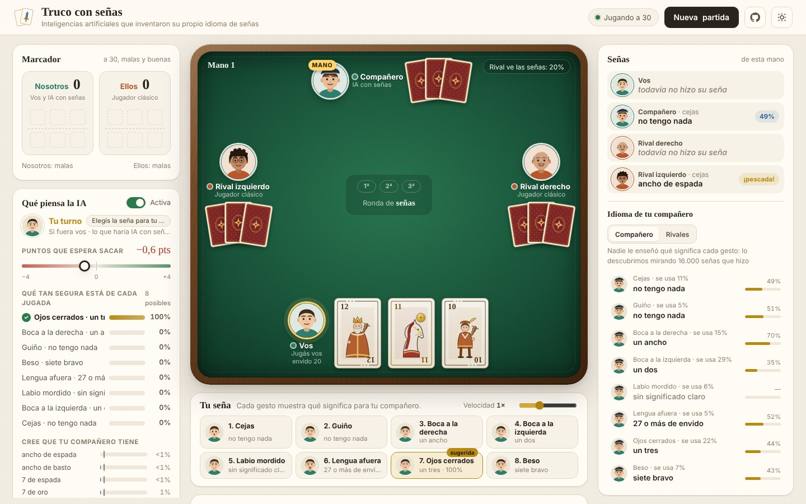</a>

<sub>No hay que instalar nada: Python, el motor del truco y las redes corren en tu navegador con Pyodide. Jugás con un compañero entrenado contra dos rivales, le hacés señas y ves en vivo qué entiende y qué piensa.</sub>

</div>

---

## La idea

En el truco de verdad los compañeros se hacen **señas** a escondidas: un guiño es el ancho de basto, levantar las cejas es el ancho de espada. Si un rival las ve, se aprovecha.

Acá, antes de cada mano, cada agente le hace a su compañero uno de **8 gestos que no significan nada**. La recompensa es ganar puntos, más un empujón chico para que la seña dependa de lo que ve el jugador; qué significa cada gesto no se le dice a nadie. Las preguntas eran tres:

1. ¿Los agentes inventan un idioma, o los gestos quedan como ruido?
2. Si lo inventan, ¿qué significa cada seña?
3. ¿Qué pasa con ese idioma cuando los rivales pueden espiar?

<details>
<summary><b>Glosario para no especialistas</b></summary>

| Término | Qué quiere decir |
|---|---|
| **Agente** o **IA** | Un jugador manejado por una red neuronal. |
| **Heurístico** o **jugador clásico** | Un jugador programado a mano, con reglas fijas y las señas de siempre del truco. Sirve de vara para medir a las IA. |
| **PPO** | El método de aprendizaje por refuerzo con el que se entrenaron: la red juega, ve si ganó o perdió y ajusta sus decisiones de a poco. |
| **Self-play** | Aprender jugando contra copias de sí misma, sin datos de partidas humanas. |
| **Iteración** | Una ronda de entrenamiento: unas 5.000 manos jugadas y una actualización de la red. |
| **Semilla** | El número que fija el azar de un entrenamiento. Dos semillas distintas son como dos parejas que aprendieron por separado. |
| **Cross-play** | Juntar como compañeros a dos IA que se entrenaron por separado, para ver si se entienden. |
| **Ablación** | Romper a propósito una pieza, como mezclar las señas, para medir cuánto aportaba. |
| **Bits** | Cuánta información lleva una seña. 0 bits es no decir nada y cada bit extra es como contestar una pregunta de sí o no. |
| **Elo** | El mismo puntaje que se usa en ajedrez: 200 puntos de diferencia es ganar aproximadamente 3 de cada 4 partidas. |
| **Intervalo de confianza (IC 95%)** | El rango donde está el valor real con un 95% de seguridad, por haber jugado una cantidad finita de partidas. |
| **MCCFR** | Un algoritmo de teoría de juegos que busca la estrategia más difícil de explotar. Es el usado en los bots de póker. |

</details>

## Qué descubrieron

### 1. Reinventaron las señas del truco

<p align="center">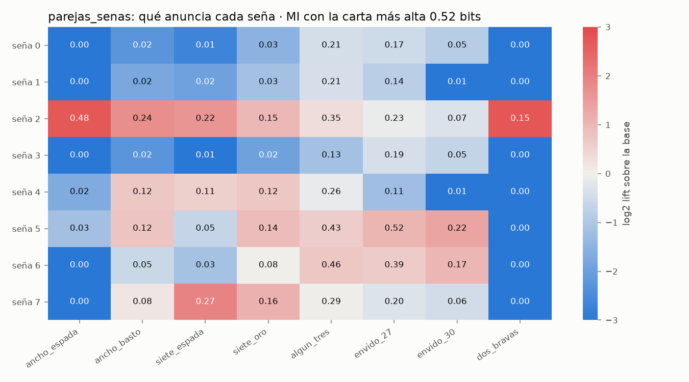</p>

Después de 3000 iteraciones de PPO (15,4 millones de manos), cada gesto pasó a anunciar algo concreto. Medido al empezar el partido, 0 a 0:

| Gesto | Qué anuncia | Qué tan seguido es cierto |
|---|---|---|
| Boca a la derecha | **tengo un ancho** | 70% |
| Lengua afuera | **tengo 27 o más de envido** | 52% |
| Ojos cerrados | tengo un tres | 44% |
| Beso | tengo un siete bravo | 43% |
| Boca a la izquierda · Cejas · Guiño | a lo sumo tengo un dos | 83% · 74% · 71% |
| Labio mordido | sin significado claro | se usa el 6% de las veces |

La seña dice **0,52 bits** sobre la mejor carta de la mano, con un intervalo bootstrap de 0,51 a 0,54. Nadie les enseñó la convención humana: llegaron solos a algo muy parecido, con la señal más fuerte en el ancho de espada, igual que en una mesa de verdad. Avisar que la mano es floja también es información para el compañero.

Ese es el diccionario del comienzo del partido. La red ve el marcador y el idioma se corre a medida que avanza. Medido con los pesos float16 de la demo, a 15 a 15 "ojos cerrados" pasa a anunciar 27 o más de envido y "beso" deja de significar algo claro, y la información sobre la mejor carta baja de 0,52 bits (0 a 0) a 0,43 (15 a 15) y 0,36 (25 a 12). "Boca a la derecha = tengo un ancho" se mantiene todo el partido. `analyze_signals.py --zero-score-prob 0.3` mide el diccionario con marcadores sorteados como en el entrenamiento.

### 2. Las señas valen partidos

<p align="center">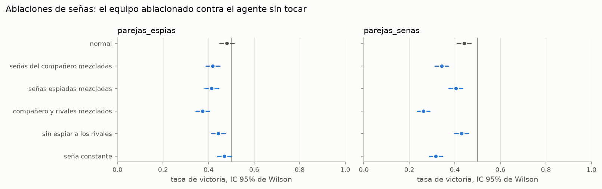</p>

Contra una copia intacta de sí mismo, un equipo al que se le mezclan las señas del compañero gana el **34%** de las partidas, y uno que hace siempre la seña más usada al empezar el partido (boca a la izquierda, que el compañero lee como "a lo sumo un dos") gana el **32%**. Por simetría, sin tocar nada tendría que ganar el 50%: escuchar al compañero vale 16 puntos de tasa de victoria (IC 95% de 13 a 19), espiar a los rivales vale 7 (de 4 a 10) y señalar vale 18 (de 15 a 21).

Una advertencia: el control sin tocar nada, con los mismos repartos, dio 44% en vez de 50%, así que parte de esas diferencias puede ser suerte de las cartas, sobre todo los 7 puntos de espiar. `scripts/ablations.py` ahora informa también cada valor ajustado por ese control y puede jugar cada reparto dos veces con las parejas cambiadas (`--duplicado`). Los números de arriba son de antes de ese cambio.

### 3. Cada pareja inventa su propio idioma

<p align="center">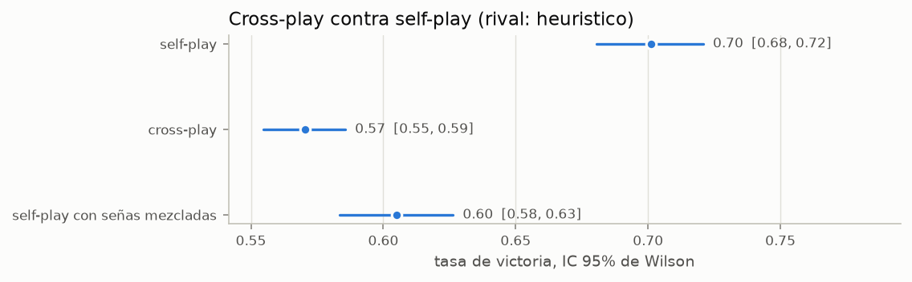</p>

Se entrenaron 5 parejas con semillas distintas. Cada una contra el heurístico gana el **70%** jugando con su propia pareja, pero si se mezclan compañeros de semillas distintas baja al **57%**. Queda parecido o apenas peor que jugar con las señas del compañero mezcladas al azar (60%): un compañero que habla otro idioma ayuda tan poco como uno que hace gestos al azar.

Los diccionarios de dos semillas coinciden un 18% de las veces, igual que por azar (20%). Reordenando los gestos para que coincidan lo mejor posible, el acuerdo sube al 55%. Lo que cambia es la palabra, no el concepto: es el resultado clásico de que **los lenguajes emergentes son convenciones arbitrarias**.

### 4. Con espías, el idioma se esconde

<p align="center">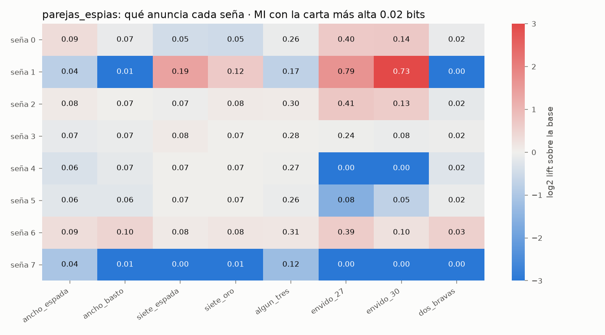</p>

Cuando cada seña tiene un 50% de chance de que la vean los rivales, los agentes **dejan de avisar sus cartas**: la información sobre la mejor carta cae de 0,52 a 0,02 bits. Lo único que siguen señalando es el envido, con 0,14 bits sobre "27 o más". Señalizar casi no vale: 3 puntos (IC 95% de 0 a 6), que no se distinguen de cero, contra 18 sin espías.

### 5. Una liga para ordenarlos a todos

<p align="center">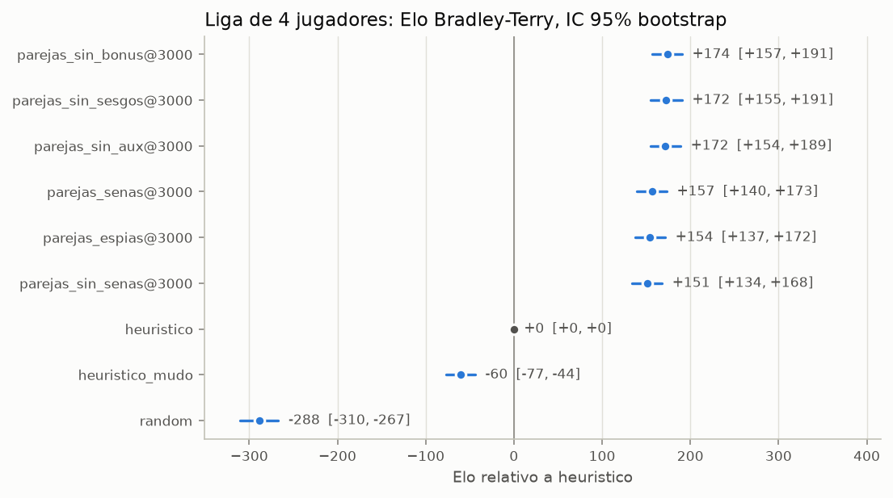</p>

Hay un torneo todos contra todos entre checkpoints de distintas iteraciones, el heurístico con señas clásicas, el heurístico mudo y un jugador aleatorio. Los ratings son de Bradley-Terry y los intervalos, por bootstrap. Con el heurístico en 0, el agente con señas termina en **+190 Elo**, el de espías en +184 y el entrenado sin señas en +177. Las diferencias, de 6 y 13 Elo, son chicas frente a la incertidumbre de cada rating: para ordenarlos haría falta compararlos directamente entre sí.

### 6. Teoría de juegos para el 1 contra 1

Para el truco mano a mano hay un **MCCFR** tabular con CFR lineal y abstracción de cartas, puntajes y apuestas. Corrió un millón de iteraciones con 5 procesos que comparten una sola tabla, usó apenas **300 MB de RAM** para unos 600.000 infosets y le gana al heurístico el **73%** de las partidas (intervalo de 68% a 77%).

<details>
<summary><b>Más figuras: curvas de aprendizaje, información por rasgo y crecimiento del MCCFR</b></summary>

<p align="center">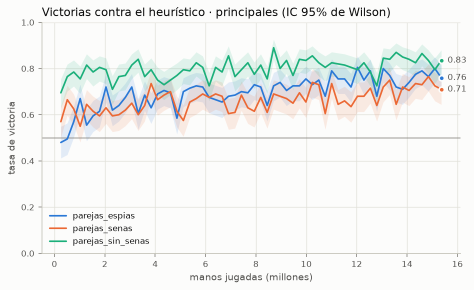</p>
<p align="center">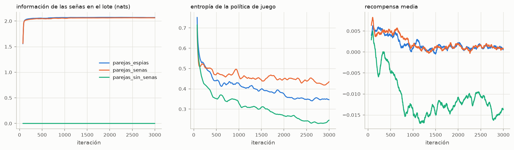</p>
<p align="center">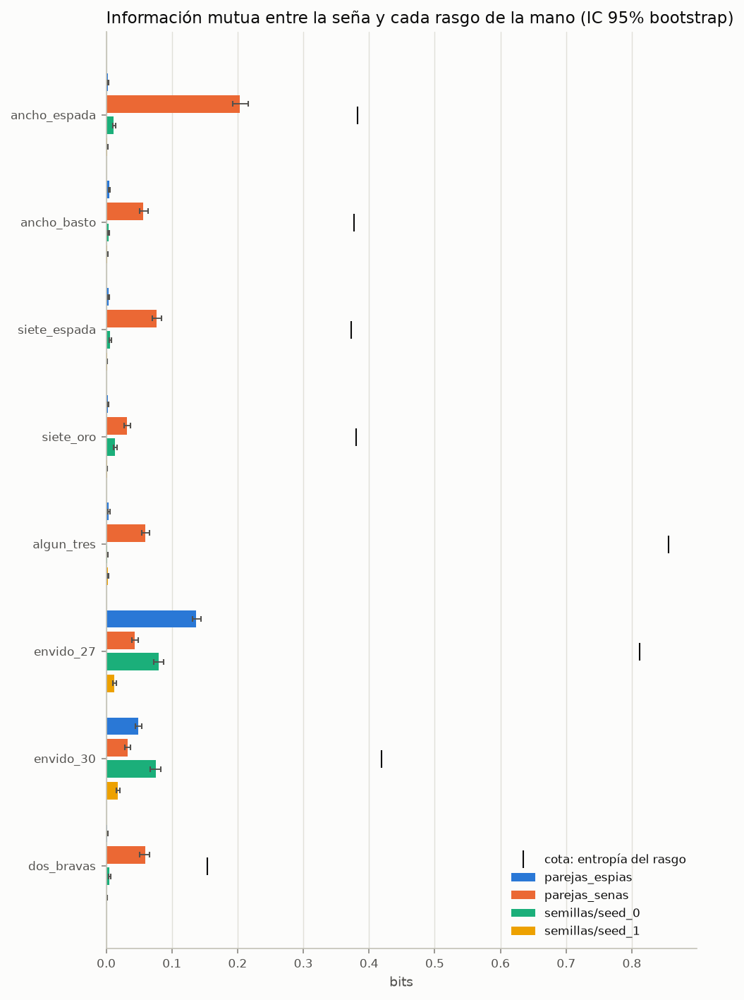</p>
<p align="center">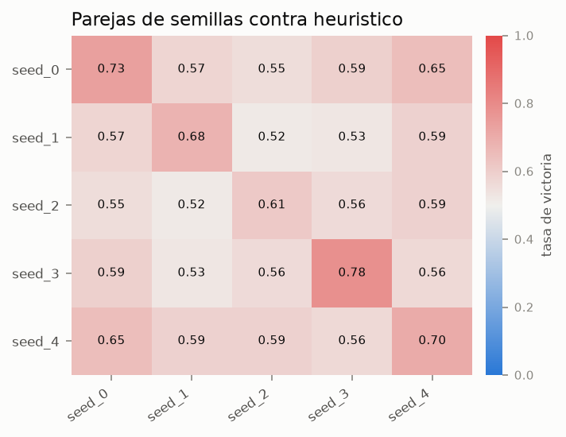</p>
<p align="center">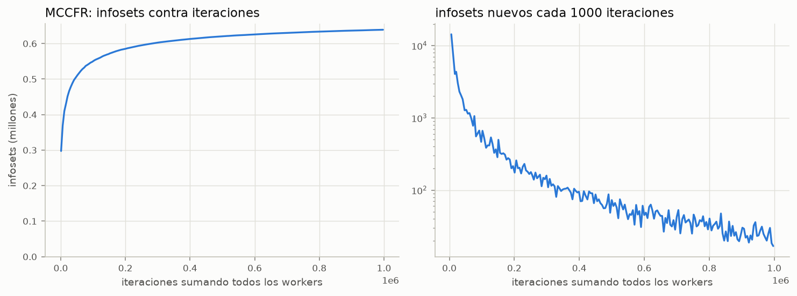</p>

</details>

## Cómo se juega la demo

1. Entrá a **[francataldi.github.io/truco-senas](https://francataldi.github.io/truco-senas/)** y esperá unos segundos a que cargue Python.
2. **Jugar:** te sentás con un compañero PPO contra dos rivales heurísticos. Antes de cada mano elegís una seña: la demo te dice qué va a entender tu compañero con cada gesto.
3. **Qué piensa la IA:** mirá qué cree tu compañero que tenés vos y qué haría la IA en tu lugar. Qué tan segura estaba de cada jugada y cuántos puntos esperaba sacar se revela al terminar la mano, para no mostrarte sus cartas antes de tiempo.
4. **Mirar:** dos parejas de agentes juegan solas, la que tiene señas contra la que no. Podés espiar las señas y ajustar la velocidad.

<details>
<summary><b>¿No sabés jugar al truco? Las reglas en 1 minuto</b></summary>

- Se juega con baraja española sin 8, 9 ni comodines, en parejas, a 30 puntos.
- Cada uno recibe 3 cartas y se juegan 3 bazas: gana la mano quien gana 2.
- Las cartas no valen por número sino por jerarquía. De mayor a menor: ancho de espada, ancho de basto, 7 de espada, 7 de oro, los tres, los dos, los anchos falsos, los doce, onces y diez, los sietes falsos, seis, cinco y cuatro.
- **Truco:** se canta para que la mano valga más (truco 2, retruco 3, vale cuatro 4). El rival acepta con "quiero" o se va y regala los puntos.
- **Envido:** antes de la primera baza se apuesta a quién tiene más puntos sumando dos cartas del mismo palo más 20.
- **Señas:** acá cada jugador hace una antes de la mano. Los rivales a veces la ven, igual que en una mesa de verdad.
- **Simplificaciones del motor:** solo responde el rival que sigue al que canta; irse al mazo en la primera baza da 1 punto aunque no se haya cantado envido; la falta envido vale lo que le falta para ganar a la pareja que va adelante, sin la regla de malas y buenas; las corridas publicadas juegan sin flor.

</details>

<p align="center">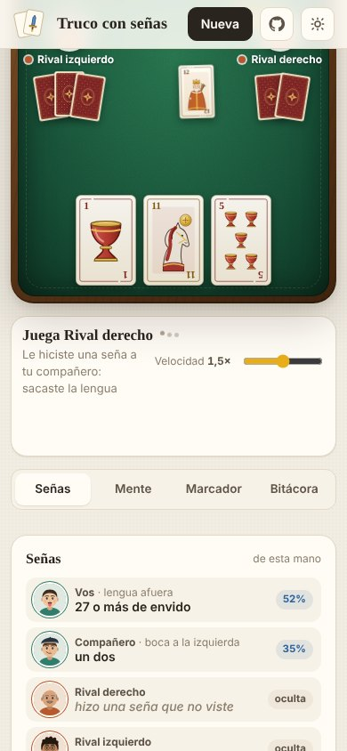</p>

## Cómo funciona

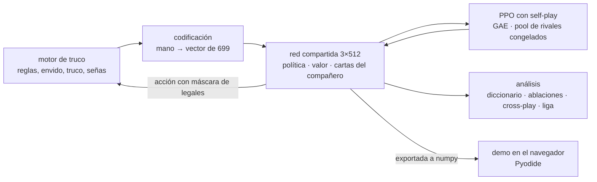

- **Self-play con parámetros compartidos.** Los 4 asientos usan la misma red. En el 20% de las manos, una pareja juega contra una foto congelada de una versión anterior, sacada de un pool de 20, para no olvidar cómo ganarle a estilos viejos.
- **La fase de señas es parte del juego.** Antes de la mano cada jugador elige uno de 8 gestos. El compañero siempre lo ve y cada rival lo ve con probabilidad `spy_prob`. La recompensa es el resultado de la mano. Nadie les dice qué significa cada gesto, pero hay dos empujones chicos para que hablen y escuchen: el bonus de información y la cabeza auxiliar.
- **Una cabeza auxiliar** predice 8 rasgos de la mano del compañero, como "tiene el ancho de espada" o "tiene 30 de envido". Eso obliga a la red a aprovechar las señas que recibe, y es lo que muestra la demo en "Cree que tu compañero tiene". Es un sesgo del que escucha: no premia directamente al que hace la seña, porque el gradiente no pasa por el gesto elegido.
- **PPO estándar:** ventajas con GAE, clipping, entropía para explorar, máscara de acciones ilegales y un bonus a la información de las señas: con peso 0,05, la pérdida premia que la seña dependa del estado del jugador (la entropía de la seña promedio menos la entropía de la seña en cada estado), sin decir de qué tiene que depender. Es un sesgo de señalización positiva como el de [Eccles et al., 2019](https://arxiv.org/abs/1912.05676). Falta el control sin ese bonus (`signal_coef: 0`) para saber si el idioma aparece igual.
- **Rendimiento:** el motor y la codificación están optimizados, y en cada iteración 5 procesos generan manos en paralelo y después la GPU hace la actualización de PPO. Así salen 3000 iteraciones, unos 15 millones de manos, en 1 h 45 min en una RTX 3060 con un Ryzen 5 5600X.
- **En el navegador:** las redes se exportan a numpy y se reimplementan sin torch: en float32 coinciden con PyTorch hasta 3·10⁻⁶. La demo usa pesos en float16 para pesar 5 MB; ahí las probabilidades cambian menos de 0,01 y la jugada más probable fue la misma en todas las decisiones de prueba. Todo el servidor de la demo corre dentro de Pyodide.

## Correrlo

```bash
git clone https://github.com/francataldi/truco-senas && cd truco-senas
pip install -e ".[dev,demo]"
python -m pytest -q
```

| Qué | Comando |
|---|---|
| Jugar por terminal | `python scripts/play.py` |
| Entrenar en CPU, prueba rápida | `python scripts/train_ppo.py --config configs/ppo_cpu.yaml` |
| Entrenar en GPU, run principal | `python scripts/train_ppo.py --config configs/ppo_3060.yaml` |
| Entrenar las tres corridas principales (con señas, sin señas y con espías) y el MCCFR | `train_3060.bat` |
| Analizar el diccionario de señas | `python scripts/analyze_signals.py --checkpoint runs/parejas_senas/last.pt` |
| Toda la investigación (semillas, MCCFR, ablaciones, cross-play, liga, reporte). Necesita antes `train_3060.bat` | `investigacion_3060.bat` |
| Controles sin el bonus de información, sin la cabeza auxiliar y sin ninguno de los dos, más su análisis con partidos duplicados, en `runs_experimentos/` | `entrenar_controles_3060.bat` |
| Solo el análisis de esos controles | `analizar_experimentos_3060.bat` |
| Que la PC no se suspenda hasta que termine el análisis de los controles, sin tocar la configuración de energía | `mantener_despierta.bat` |
| Demo local con servidor | `python scripts/serve.py --open` |
| Armar la demo estática para GitHub Pages | `python scripts/build_web.py --runs runs --dictionaries runs/reporte` |

Los `.bat` son para Windows, pero cada línea es un comando de Python que corre igual en Linux o macOS cambiando `\` por `/`.

## Qué hay en el repo

```
truco/          motor: cartas, reglas, mano y partida, codificación, máscara de acciones
truco/web/      frontend de la demo: HTML, CSS y JS sin build, con las cartas dibujadas en SVG
agents/
  heuristic.py  heurístico con las señas clásicas del truco
  ppo/          red, rollouts en paralelo, PPO, agente y versión numpy sin torch
  cfr.py        MCCFR con abstracción compacta y tabla en memoria compartida
  signal_analysis.py, ablations.py, crossplay.py, league.py, report.py
demo/           servicio de partidas, mente del agente y diccionarios, FastAPI y backend para Pyodide
scripts/        entrenar, evaluar, analizar, jugar, servir y publicar
docs/           demo publicada en GitHub Pages
tests/          133 tests, también en CI sobre Ubuntu y Windows
```

## Créditos

PPO ([Schulman et al., 2017](https://arxiv.org/abs/1707.06347)), MCCFR (Lanctot et al., 2009), CFR lineal ([Brown y Sandholm, 2019](https://arxiv.org/abs/1809.04040)), comunicación emergente en juegos cooperativos ([Foerster et al., 2016](https://arxiv.org/abs/1605.06676)), sesgos para que la comunicación emerja ([Eccles et al., 2019](https://arxiv.org/abs/1912.05676)) y la prueba de cross-play ([Hu et al., 2020](https://arxiv.org/abs/2003.02979)). La demo corre sobre [Pyodide](https://pyodide.org/).

<div align="center"><sub>Hecho por <a href="https://www.linkedin.com/in/franco-cataldi-gagliardi-2347a9268">Franco Cataldi Gagliardi</a> · también hice <a href="https://github.com/francataldi/clima-ensambles">un pronóstico del clima global por ensambles</a></sub></div>
