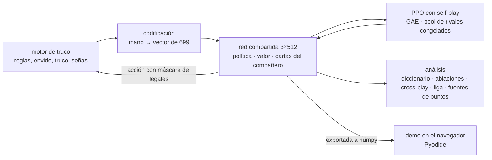

# truco-senas · detalles técnicos

Aprendizaje por refuerzo multiagente con PPO y parámetros compartidos, comunicación emergente, un baseline de teoría de juegos con MCCFR y una demo que corre entera en el navegador con Pyodide. La explicación para no especialistas está en el [README](README.md).

## Cómo funciona



- **Self-play con parámetros compartidos.** Los 4 asientos usan la misma red, un MLP de 3 capas de 512 (Linear, LayerNorm, GELU) con 901.148 parámetros y tres cabezas: política, valor y auxiliar. La observación es relativa al que mira. En el 20% de las manos una pareja juega contra una foto congelada de una versión anterior, sacada de un pool de 20.
- **Episodio = una mano**, que arranca con un marcador sorteado (30% de las veces 0 a 0), así aprende los finales de partido y la falta envido. La recompensa es la diferencia de puntos de la mano dividida por 4, con γ = 1 y λ = 0,95.
- **La fase de señas es parte del juego.** Antes de la mano cada jugador elige uno de 8 gestos (acciones 11 a 18). El compañero siempre lo ve y cada rival lo ve con probabilidad `spy_prob`. Las acciones ilegales reciben un logit de −10⁹.
- **Cabeza auxiliar** (`aux_coef: 0.1`): predice 8 rasgos de la mano del compañero, como "tiene el ancho de espada" o "tiene 30 de envido". Es un sesgo del que escucha: el gradiente no pasa por el gesto elegido. Es lo que la demo muestra en "Qué puede tener tu compañero".
- **Bonus de información** (`signal_coef: 0.05`): premia que la seña dependa del estado del jugador, sin decir de qué. Es un sesgo de señalización positiva como el de [Eccles et al., 2019](https://arxiv.org/abs/1912.05676):

$$
\mathcal{B} = \mathcal{H}\big(\bar\pi_{\text{seña}}\big) - \frac{1}{N}\sum_{i=1}^{N} \mathcal{H}\big(\pi_{\text{seña}}(\cdot \mid s_i)\big)
$$

- **PPO** con ventajas GAE, recorte, bonus de entropía y learning rate con decaimiento coseno:

$$
L(\theta) = -\,\mathbb{E}_t\Big[\min\big(\rho_t \hat A_t,\ \operatorname{clip}(\rho_t, 1-\epsilon, 1+\epsilon)\,\hat A_t\big)\Big] + c_v\,\mathbb{E}_t\big[(V_\theta(s_t) - \hat R_t)^2\big] - c_e\,\mathbb{E}_t\big[\mathcal{H}(\pi_\theta(\cdot \mid s_t))\big]
$$

- **Información mutua** entre la seña S y un rasgo H de la mano, con un intervalo bootstrap y una nula por permutación:

$$
I(S;H) = \sum_{s,h} p(s,h)\,\log_2 \frac{p(s,h)}{p(s)\,p(h)}
$$

- **Acierto**, la medida que usa el README: la probabilidad de adivinar la categoría de la mejor carta con la mejor regla posible, sin la seña y con ella:

$$
\text{acierto}_{\text{sin}} = \max_h p(h) \qquad \text{acierto}_{\text{con}} = \sum_s p(s)\,\max_h p(h \mid s)
$$

- **MCCFR** para el mano a mano: muestreo externo, CFR lineal y abstracción de cartas por fuerza, envido en 5 tramos, marcador en 2 y apuestas compactas. Las claves se hashean a int64 y los regrets van en float32, en una tabla de memoria compartida entre procesos (unos 56 bytes por infoset). Un millón de iteraciones con 5 procesos usaron unos 300 MB de RAM por proceso para 593.356 infosets; la política exportada pesa 4,8 MB.
- **Rendimiento:** en cada iteración 5 procesos generan 1.024 manos cada uno, 128 a la vez, y después la placa de video hace 4 épocas de PPO con minibatch de 8.192 en bf16. Así salen 3.000 iteraciones, 15,4 millones de manos, en menos de dos horas en una PC de escritorio.
- **En el navegador:** las redes se exportan a numpy y se reimplementan sin torch, con GELU vía `erf` aproximada: en float32 coinciden con PyTorch hasta 3·10⁻⁶. La demo usa pesos float16 (las probabilidades cambian menos de 0,01). Todo `demo/service.py` corre dentro de Pyodide 0.27.8; `truco/web/js/api.js` le habla a Pyodide cuando la página tiene `data-backend="local"`.

## Las mediciones, con su nombre técnico

| Medición | Resultado | De dónde sale |
|---|---|---|
| Información de la seña sobre la mejor carta, 0 a 0 | 0,52 bits (bootstrap 0,51 a 0,54; nula p95 0,0005) | `runs/parejas_senas/senas/diccionario.json` |
| Misma medida con marcadores sorteados | 0,42 bits (0,41 a 0,42) | `analyze_signals.py --zero-score-prob 0.3` |
| A 15 a 15 y a 25 a 12, pesos float16 | 0,43 y 0,36 bits | demo |
| Acierto sobre la mejor carta, sin seña y con seña | 22% y 41% (marcador sorteado: 36%) | `acierto_carta_mas_alta` en el diccionario |
| Ablaciones espejo con partidos duplicados, 1.000 por condición | control 49,4% (46,3 a 52,5); escuchar 16 pts (13 a 19); señalar 17 (14 a 20); todas 21 (18 a 23); espiar 1 (−2 a 4); rivales mezclados 7 (4 a 10). Ajustados por el control cambian menos de 0,3 pts | `ablations.py --duplicado` |
| Cross-play entre 5 semillas de 800 iteraciones | self-play 70% contra el heurístico, cross-play 57%, señas mezcladas 60%; acuerdo de diccionarios 18% (azar 20%), 55% con la mejor permutación | `crossplay.py` |
| Espías (`spy_prob: 0.5`) | 0,02 bits sobre la mejor carta, 0,14 sobre envido 27 o más; señalar −2 pts (−5 a 1); escuchar 5 (2 a 8) | `runs/parejas_espias` |
| Controles sin bonus, sin auxiliar y sin ninguno | 0,46 · 0,22 · 0,39 bits; escuchar 14 · 14 · 13 pts | `entrenar_controles.bat` |
| Contra el heurístico, 2.000 duplicados | con señas 74,4%, espías 75,2%, sin señas 77,0% (84,5% en mesa sin señas), controles 72,0 a 75,0% | `evaluate.py --duplicado` |
| Ablaciones contra el heurístico, 1.000 duplicados | con señas: normal 74,1%, sin espiar 77,7% (espiar −3,6 pts, IC −6,4 a −0,9), ruido en vez de las señas del heurístico 73,6%, compañero mezclado 52,7%, gesto fijo 47,7%. Sin sesgos: 73,9% y 78,5%. Espías: 74,9% y 76,1% | `ablations.py --opponent heuristic --duplicado` |
| Fuentes de puntos contra el heurístico, 2.000 duplicados | con señas +0,28 por mano: envido +0,19, cartas +0,09, truco no querido +0,26, mazo −0,26. Sin señas +0,35: +0,15, +0,09, +0,41, −0,30 | `comparar.py` |
| Cara a cara con señas contra sin señas | 53,0% (50,9 a 55,2), +0,06 por mano | `comparar.py` |
| Heurístico con señas contra heurístico mudo | 67,0% (64,9 a 69,0), toda la diferencia en truco no querido | `comparar.py` |
| MCCFR contra el heurístico, 1 contra 1 | 72,4% (70,4 a 74,3), +0,19 por mano | `comparar.py --players 2` |
| PPO 1 contra 1 (`ppo_duelo_corto.yaml`: 1.500 iteraciones, 3,1 M de manos, CPU) contra el heurístico | 86,6% (85,0 a 88,0) con `evaluate.py --duplicado`; 85,0% (83,4 a 86,6) con `comparar.py`, +0,32 por mano: envido +0,21, cartas +0,16, truco no querido +0,17, mazo −0,22 | `runs/duelo` |
| PPO 1 contra 1 contra MCCFR | 52,8% (50,7 a 55,0), +0,02 por mano: envido +0,02, cartas +0,04, truco no querido −0,04 | `comparar.py --players 2` |
| Liga Bradley-Terry de 9 jugadores, 400 partidos por cruce | IA entre +151 y +174 Elo, heurístico mudo −60, azar −288 | `league.py` |

Para reproducir la investigación de por qué la IA sin señas le gana más al heurístico, y la del mano a mano:

```bash
python scripts/ablations.py --checkpoint runs/parejas_senas/last.pt --opponent heuristic --spy 0.2 --matches 1000 --duplicado --out runs_investigacion/ablaciones_vs_clasico/parejas_senas
python scripts/comparar.py --a ppo:runs/parejas_senas/last.pt --matches 2000 --workers 5 --json runs_investigacion/comparaciones/senas_vs_clasico.json
python scripts/comparar.py --a ppo:runs/parejas_sin_senas/last.pt --matches 2000 --workers 5 --json runs_investigacion/comparaciones/sin_senas_vs_clasico.json
python scripts/comparar.py --a ppo:runs/parejas_senas/last.pt --ruido '{"blind_a": true}' --matches 2000 --workers 5
python scripts/comparar.py --a ppo:runs/parejas_senas/last.pt --b ppo:runs/parejas_sin_senas/last.pt --matches 2000 --workers 5
python scripts/comparar.py --a heuristic --b heuristic-mudo --matches 2000
python scripts/comparar.py --a cfr:runs/cfr/heads_up.npz --players 2 --matches 2000
python scripts/train_ppo.py --config configs/ppo_duelo_corto.yaml
python scripts/evaluate.py --a ppo:runs/duelo/last.pt --players 2 --matches 2000 --duplicado --json runs/duelo/vs_heuristico.json
python scripts/comparar.py --a ppo:runs/duelo/last.pt --players 2 --matches 2000 --json runs_investigacion/comparaciones/duelo_vs_clasico.json
python scripts/comparar.py --a ppo:runs/duelo/last.pt --b cfr:runs/cfr/heads_up.npz --players 2 --matches 2000
python scripts/figura_fuentes.py --json runs_investigacion/comparaciones/senas_vs_clasico.json runs_investigacion/comparaciones/sin_senas_vs_clasico.json --nombres "IA con señas" "IA sin señas" --out docs/img/fuentes_vs_clasico.png
python scripts/figura_fuentes.py --json runs_investigacion/comparaciones/duelo_vs_clasico.json runs_investigacion/comparaciones/cfr_vs_clasico_1v1.json --nombres "IA de mano a mano" "Bot de teoría de juegos" --out docs/img/fuentes_mano_a_mano.png
```

`comparar.py` cuenta como "mentira" un envido cantado con menos de 25 o un truco cantado sin ninguna carta mejor que un dos entre las que le quedan. Las fuentes de puntos son exactas: envido, mano ganada con las cartas (con o sin truco), truco no querido y mazo suman los puntos de cada mano.

## Correrlo

```bash
git clone https://github.com/francataldi/truco-senas && cd truco-senas
pip install -e ".[dev,demo]"
python -m pytest -q
```

| Qué | Comando |
|---|---|
| Jugar por terminal | `python scripts/play.py` |
| Entrenar en CPU, prueba rápida | `python scripts/train_ppo.py --config configs/ppo_cpu.yaml` |
| Entrenar la corrida principal | `python scripts/train_ppo.py --config configs/ppo_principal.yaml` |
| Analizar el diccionario de señas | `python scripts/analyze_signals.py --checkpoint runs/parejas_senas/last.pt` |
| Comparar dos bots y ver de dónde saca los puntos cada uno | `python scripts/comparar.py --a ppo:runs/parejas_senas/last.pt --b heuristic` |
| Entrenar las tres corridas principales y el MCCFR | `entrenar_principales.bat` |
| Toda la investigación: semillas, MCCFR, ablaciones, cross-play, liga y reporte. Necesita antes `entrenar_principales.bat` | `investigacion.bat` |
| Controles sin bonus, sin cabeza auxiliar y sin ninguno, más su análisis, en `runs_experimentos/` | `entrenar_controles.bat` |
| Solo el análisis de esos controles; si se corta, retoma | `analizar_controles.bat` |
| Entrenar todo más largo y explicar quién le gana a quién: primero la IA con señas con 4 veces más manos (unas 7 horas y media en una placa de gama media), después una IA de mano a mano, las otras dos IA en pareja y el bot de teoría de juegos con 5 veces más repartos, y después diccionarios, mediciones contra el clásico, ablaciones, comparaciones de puntos, figuras, ligas y reporte, todo en `runs_largo/`. Tarda alrededor de un día; si se corta, se vuelve a abrir y sigue | `entrenar_todo.bat` |
| Que Windows no se suspenda mientras algo corre, sin tocar la configuración de energía. Los bats largos ya lo abren solos | `mantener_despierta.bat` |
| Demo local con servidor | `python scripts/serve.py --open` |
| Armar la demo estática para GitHub Pages | `python scripts/build_web.py --runs runs --dictionaries runs/reporte` |

Los `.bat` son para Windows y encuentran solos un Python con torch y CUDA (`scripts/buscar_python.bat`). Cada línea es un comando de Python que corre igual en Linux o macOS cambiando `\` por `/`.

## Qué hay en el repo

```
truco/              motor: cartas, reglas, mano y partida, codificación, máscara de acciones
truco/web/          frontend de la demo: HTML, CSS y JS sin build, con las cartas dibujadas en SVG
agents/
  heuristic.py      jugador clásico con las señas de siempre del truco
  ppo/              red, rollouts en paralelo, PPO, agente y versión numpy sin torch
  cfr.py            MCCFR con abstracción compacta y tabla en memoria compartida
  behavior.py       fuentes de puntos y comportamiento de cada bot
  signal_analysis.py, ablations.py, crossplay.py, league.py, report.py, stats.py
demo/               servicio de partidas, mente del agente y diccionarios, FastAPI y backend para Pyodide
scripts/            entrenar, evaluar, comparar, analizar, jugar, servir y publicar
configs/            corridas principales, controles, largas, mano a mano y prueba en CPU
docs/               demo publicada en GitHub Pages e imágenes del README
tests/              146 tests, también en CI sobre Ubuntu y Windows
```

## Créditos

PPO ([Schulman et al., 2017](https://arxiv.org/abs/1707.06347)), MCCFR (Lanctot et al., 2009), CFR lineal ([Brown y Sandholm, 2019](https://arxiv.org/abs/1809.04040)), comunicación emergente en juegos cooperativos ([Foerster et al., 2016](https://arxiv.org/abs/1605.06676)), sesgos para que la comunicación emerja ([Eccles et al., 2019](https://arxiv.org/abs/1912.05676)) y la prueba de cross-play ([Hu et al., 2020](https://arxiv.org/abs/2003.02979)). La demo corre sobre [Pyodide](https://pyodide.org/).
